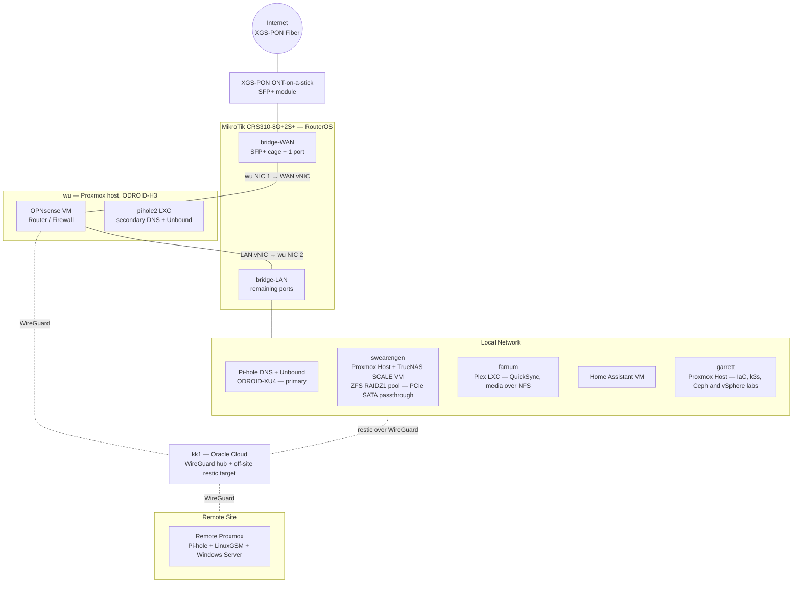

# greenbeanorg — Andy's Homelab

Multi-site homelab infrastructure, documented as production-style runbooks. I'm a Linux systems professional and this is where I design, break, fix, and document infrastructure.

**Everything here is real and running** — four Proxmox hosts across two sites, ZFS storage on TrueNAS SCALE, OPNsense edge routing over XGS-PON fiber, automated verified backups, and a containerized service stack.

## Repositories

| Repo | What it is |
| --- | --- |
| [homelab-automation](https://github.com/greenbeanorg/homelab-automation) | Runbooks and IaC - terraform and ansible configuration files |
| [homelab-docs](https://github.com/greenbeanorg/homelab-docs) | Runbooks and design docs: storage, backup, networking, power, services |
| [homelab](https://github.com/greenbeanorg/homelab) | Sanitized configs: Docker Compose stacks, NUT, restic scripts, tooling |

## Network at a glance

**Traffic path:** fiber terminates on the ONT SFP+ in the switch's isolated **bridge-WAN**, which hands off to a dedicated NIC on `wu`; the OPNsense VM routes/firewalls and sends LAN-bound traffic out a second NIC back into the switch's **bridge-LAN** — router-on-a-VM with a physical hairpin through the CRS310.

## Current projects

- **Nested vSphere 8 lab** — two-host ESXi 8 cluster with vCenter on Proxmox, built with the CLI installer and `govc`: distributed switch, NFS shared datastore, shared-nothing and shared-storage vMotion with zero packet loss, and vSphere HA with a tested host failure — VM restarted on the surviving host ([runbook](https://github.com/greenbeanorg/homelab-docs/blob/main/VSPHERE-NESTED-LAB.md))
- **Kea MCP server** — read-only Model Context Protocol tools over the Kea DHCP API: lease lookup, pool utilization, health, and `ha_status`, which checks both HA peers and flags an unreachable peer, split brain, or no peer serving
- **Ceph lab** — three-node Ceph cluster on garrett: MON quorum, MGR and one OSD per host to `HEALTH_OK`, on lab-only bridges ([runbook](https://github.com/greenbeanorg/homelab-docs/blob/main/CEPH-LAB-FOUNDATION.md))
- **Proxmox cluster design** — three home hosts into one cluster with ZFS replication, selective HA and a Proxmox Backup Server; design stage, with the router host's quorum risk worked through first ([design doc](https://github.com/greenbeanorg/homelab-docs/blob/main/PVE-CLUSTER-DESIGN-2026-10.md))

## Up next

- **Ansible fleet management** — host configuration (baseline, NUT, restic, Docker hosts) as Ansible roles across all sites
- **Monitoring modernization** — Prometheus, Grafana and node_exporter across the fleet

## Recently completed

- Kea DHCP high availability — hot-standby pair on Kea 3.0 across two Proxmox hosts, each with its own PostgreSQL lease database; configs in Git with a drift check, and a scripted failover test: ~58 s failover, a client served by the standby, its lease synced back on failback ([runbook](https://github.com/greenbeanorg/homelab-docs/blob/main/KEA-DHCP-HA.md))
- Kea DHCP lab — ISP-style relayed DHCPv4 on Rocky Linux 9 (SELinux enforcing): OPNsense relay with option 82, circuit-id reservations, PostgreSQL lease backend, Kea HTTP API, and a perfdhcp load test to saturation ([runbook](https://github.com/greenbeanorg/homelab-docs/blob/main/KEA-DHCP-LAB.md))
- Infrastructure as code — Terraform and Ansible provision a three-node k3s cluster, PostgreSQL and Icinga2 on garrett, deploy a Flask + PostgreSQL app, and publish it over TLS through a reverse proxy on a cloud host — live at [tasks.greenbean.org](https://tasks.greenbean.org) ([runbook](https://github.com/greenbeanorg/homelab-automation/blob/master/RUNBOOK.md))
- Plex VM → LXC with Intel QuickSync hardware transcoding ([runbook](https://github.com/greenbeanorg/homelab-docs/blob/main/PLEX-LXC-GPU-MIGRATION.md))
- Redundant DNS — two Pi-hole v6 resolvers in separate failure domains, each with its own validating Unbound recursive resolver ([runbook](https://github.com/greenbeanorg/homelab-docs/blob/main/DNS.md))
- WireGuard hub-and-spoke overlay through a cloud instance, so neither site needs an inbound port ([runbook](https://github.com/greenbeanorg/homelab-docs/blob/main/WIREGUARD.md))
- Root-cause write-ups: a hypervisor hang traced to a wedged USB controller, a memory/MCE investigation, and a "bridge bug" corrected to a guest's /32 prefix ([runbooks](https://github.com/greenbeanorg/homelab-docs))
- VLAN segmentation — flat L2 network redesigned into trust zones on the CRS310
- 30TB storage migration: mdadm RAID5 → TrueNAS SCALE / ZFS RAIDZ1 with PCIe SATA passthrough ([runbook](https://github.com/greenbeanorg/homelab-docs))
- SSHFS → NFS for all cross-host storage access
- Off-site restic backups of TrueNAS to the cloud WireGuard hub, with scheduled integrity checks ([runbook](https://github.com/greenbeanorg/homelab-docs/blob/main/RESTIC-BACKUP.md))
- PowerPanel → NUT UPS monitoring: a dedicated Pi 2B as primary, staggered shutdown across three hosts with storage first, reboot-tested ([runbook](https://github.com/greenbeanorg/homelab-docs/blob/main/UPS.md))
- Early adopter of the XGS-PON ONT-on-a-stick guide ([pon.wiki guide](https://pon.wiki/guides/masquerade-as-the-att-inc-bgw320-500-505-with-the-was-110/))

---

📫 https://linkedin.com/in/andy-alexander-linux · Ormond Beach, FL · open to remote systems roles
